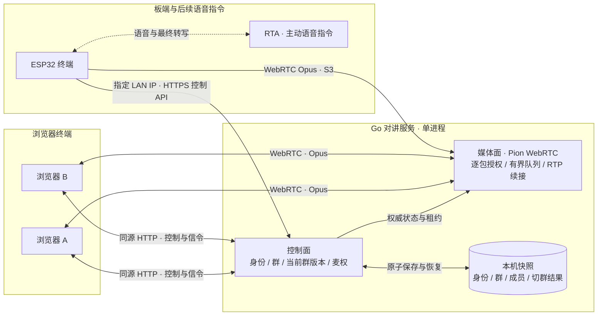
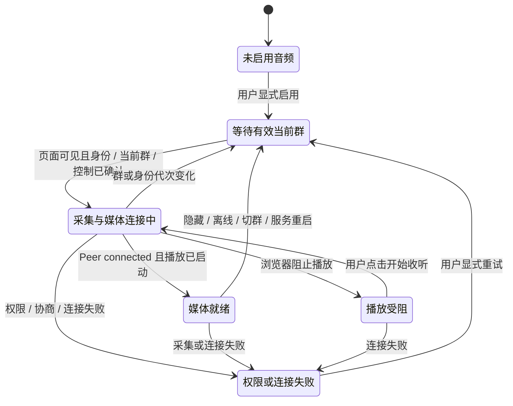
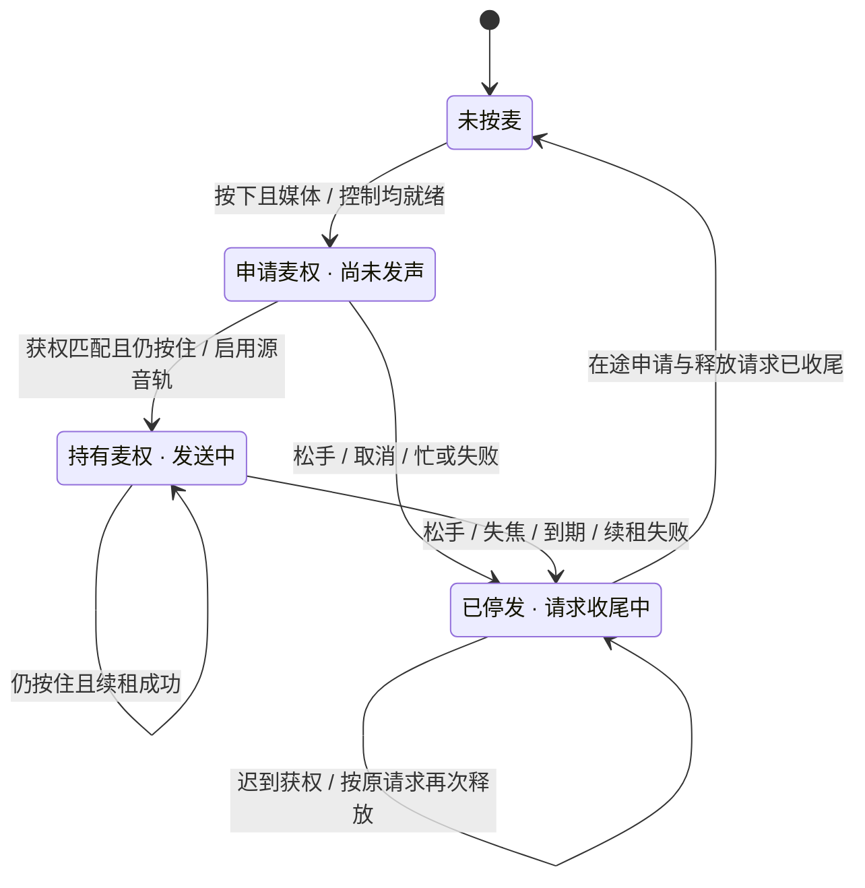
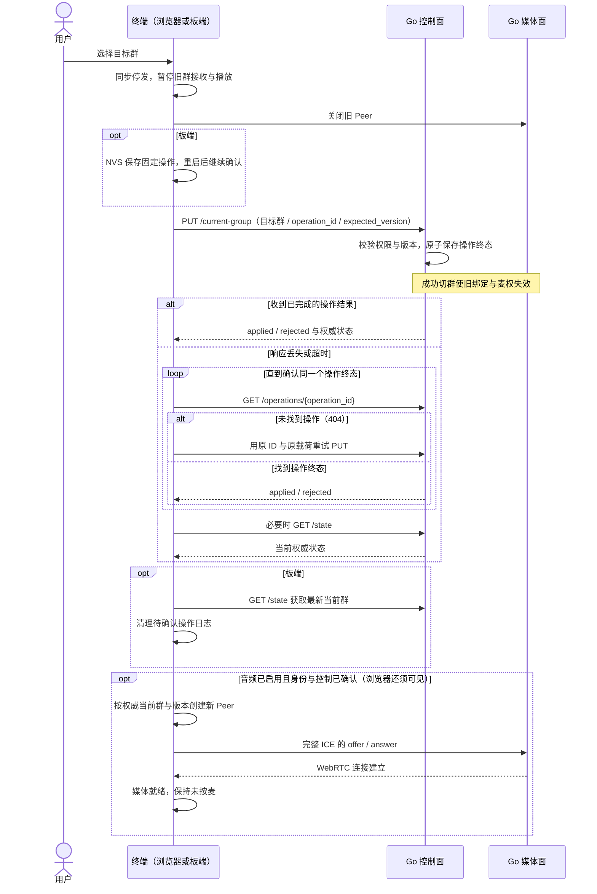

# 声路同行 · Miku Intercom

面向小组即时协作的智能语音对讲工具。让分散的小组随时沟通，需要协助时，一句话找到对的组。活动执行、户外结伴、车队出行都可使用同一套核心能力。

首版目标：快速建群与口令入群、按住说话、按群名语音切换、断线后可信恢复。根据需求推荐协作群为增强项。普通群音频由独立对讲服务转发，RTA 只用于主动触发的语音指令。

S1 群控制面与 S2 浏览器 WebRTC 群音频已合入 main（[PR #6](https://github.com/iewiad/miku-intercom/pull/6)）。真实系统麦克风采集与传输已有数值验证，诊断扩展及证据已随 [PR #7](https://github.com/iewiad/miku-intercom/pull/7) 合并；人工听测待完成。S3 首切片已随 [PR #10](https://github.com/iewiad/miku-intercom/pull/10) 合并，验证一板一浏览器的真实麦克风双向传输、松手停发及服务重启恢复。PR #11 已合并板端已加入群切换，已完成三群隔离、十次连续切换及待确认操作跨软重启恢复；人工听测、板端口令键盘、主动语音切群与需求推荐仍待完成。实际验证以[验收记录](docs/acceptance.md)及对应 PR 为准。

## 系统架构

实线为当前浏览器及本分支板端实现，虚线为后续语音指令接入。控制面和媒体面在同一个 Go 进程中，通过权威状态配合工作。



普通群音频经媒体面转发给同群其他成员，控制面是身份、当前群与麦权的唯一授权来源。源包入队与目标写出前都重新校验权限；麦权与 Peer 只保存在内存，服务重启后清空。RTA 群指令集成待实现；复用固件此前的一对一 RTA 验收见验收记录。默认部署保持 localhost；S3 通过完整显式参数开放指定 LAN IP 的设备 HTTPS 与 UDP 入口，配置见[开发指南](docs/development.md#s3-板端-lan-开发入口)。板端实际证据单独记录，不外推到公网。

## 连接与发言状态

### 浏览器音频连接

用户显式启用后才请求麦克风。Peer 已连接、远端播放已启动且绑定仍有效，才进入媒体就绪；它还不代表已经获权讲话。



任意状态点击“关闭音频”都会停止采集、关闭 Peer 并回到未启用。自动恢复只发生在用户已选择启用、页面可见且控制状态重新确认后，始终回到未按麦；权限或连接失败保留显式重试。隐藏、离线或切群会停止采集并关闭旧 Peer；收听静音只控制播放，单纯窗口失焦只取消发言。

### 按住说话（PTT）

抢麦是独立状态机：按下时仍保持源音轨禁用；只有 ACK 匹配当前 Peer、群版本及请求代次，并且用户仍按住，才开始发送。



结束时先同步禁用源音轨，再异步释放麦权；普通松手保留采集和 Peer，下一次按下重新申请。忙时不排队，迟到授权不恢复发送，重连也不自动按麦。服务端逐包门控继续兜底；已经进入网络或播放缓冲的尾音无法撤回。

## 手动切群交互

已加入群与当前群分开，加入第二个群不会自动打断当前群。主动切换会关闭旧媒体，确认操作终态后再按权威当前群重建连接。



结果未知时保持媒体关闭，并查询或重试同一操作；单次当前群快照不能代替操作终态。成功或拒绝后都以最新权威状态恢复，媒体连接失败时显示失败并保留重试入口。接口字段与完整异常语义见 [002](docs/specs/002-control-api.md) / [003](docs/specs/003-browser-media.md)。

板端通过已加入群下拉列表和确认按钮执行切换，权威当前群单独显示。停止和软重启会保留待确认操作，恢复后保持未按麦。详情与状态图见 [005](docs/specs/005-device-multigroup.md)，实际范围见[多群验收](docs/acceptance.md#s3-板端多群切换)；板端口令键盘与语音切群后续接入。

## 从这里开始

| 需要了解什么 | 入口 |
| --- | --- |
| 用户、范围、交互与演示 | [产品定义](docs/product.md) |
| 组件职责、状态与媒体边界 | [架构](docs/architecture.md) |
| 本机启动、测试与开发顺序 | [开发指南](docs/development.md) |
| 必交闭环与验收条件 | [MVP 规格](docs/specs/001-intercom-mvp.md) |
| 控制面 API | [控制面契约 v1](docs/specs/002-control-api.md) |
| 浏览器群媒体、门控与诊断 | [媒体契约 v1](docs/specs/003-browser-media.md) |
| 哪些已经通过、哪些仍待验证 | [验收记录](docs/acceptance.md) |

## 目录

```text
server/                     独立 Go 对讲服务、群媒体与同源浏览器
firmware/esp32-s31-rti/      复用板端工程；保留内部工程名与协议标识
reference/rta-browser/      原 RTA 示例，仅作接口和生命周期参考
docs/                      产品、架构、规格和实际验收证据
work/                      本机状态、构建和临时资料，Git 忽略
```

本机开发入口与测试命令见[开发指南](docs/development.md)。群控制流程、浏览器实音频、板端接入、语音切群按切片推进，任何阶段都不以 UI 提示替代实际音频验收。

## 来源与项目边界

戴伟（MIKU-流媒体）参加 Qiniu Builder Day 的项目；开发截止 2026-10-26 09:00（Asia/Shanghai）。当前仓库保持私有，公开前须核验内部源码再分发授权、依赖与字体许可及凭据。

新增对讲功能前的远端 `v0` 指向 `d713a5a9d32039cdeeacca90503ba184f865b6c3`。逐文件来源见 [v0 清单](docs/v0-manifest.json)：板端来源为旧工程 `02b8433` 加选定工作树改动，并非该提交的纯净快照；浏览器参考来源为 `qbox/miku-rti` 的 `f1c3722`，共 37 个原文件。未导入凭据、生成物或日志，也不在参考仓库中开发本项目。

`reference/rta-browser/` 的旧运行说明依赖原仓库，不能在此直接照搬；其一对一 AI 音频链路不承担群音频转发。
