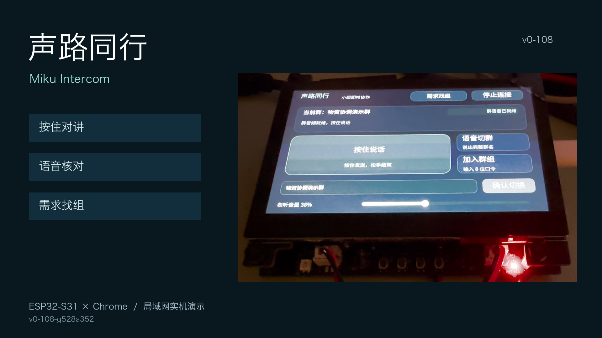

# 声路同行 · Miku Intercom

**让分散的小组随时沟通，需要协助时，一句话找到对的组。**

声路同行把浏览器与 ESP32 触屏终端接入同一套群对讲：按住说话，松手结束；知道群名就说出目标，不知道该找谁就描述需求。查看候选并明确确认后，再进入目标群继续交流。

[观看实机演示](https://github.com/iewiad/miku-intercom/releases/tag/v0-rc-20261025) · [阅读视频导读](docs/demo-review-guide.md) · [开始体验](docs/first-run.md)

[](https://github.com/iewiad/miku-intercom/releases/tag/v0-rc-20261025)

## 为现场协作少找一步

临时活动中，全员沟通、设备排障、物资协调常在不同小组之间发生。声路同行让成员始终看清当前群和发言状态，在需要协助时找到对应的小组。

| 想做什么 | 怎样操作 | 接下来会发生什么 |
| --- | --- | --- |
| 向当前小组说一句话 | 连接群语音，按住“按住说话” | 获得发言权后发送，松手停发；同一群同一时刻一人讲话 |
| 已经知道目标群 | 主动点“语音切群”，等允许说话后说“帮我转到设备排障演示群吧” | 核对本次识别文字和候选，点击明确确认按钮，等待目标群就绪 |
| 需要帮助，但不知道群名 | 进入板端“需求找组”或浏览器“说出需求”，等允许后说“我需要领取和补充活动物资” | 查看建议群的职责，明确确认后再进入对应群对讲 |

群名和职责由小组自行配置，示例中的设备组与物资组使用同一套功能。候选只来自已加入且有权限的群；浏览器点击卡内确认按钮，板端先选卡再单独确认。仅查看建议或在板端选卡不会切群，推荐也不表示已经有人在线或接听。

## 浏览器与触屏一起用

| 终端 | 适合做什么 |
| --- | --- |
| Chrome 浏览器 | 建群并分享口令、加入多个群、填写和筛选群职责、按住对讲、语音切群、文字或语音需求找组 |
| ESP32-S31-Korvo-1 触屏终端 | 输入群口令加入，以大面积按钮对讲，手动或语音切群，主动说出需求找组，调整收听音量 |

加入新群与切换当前群分开：第一个群自动进入，再加入其他群不会打断当前沟通。连接、群名和发言状态分别显示；切换或重连后保持未按麦，准备好后再主动发言。

## 开始体验

在仓库根目录运行，需 Python 3 和项目要求的 Go（版本见[开发指南](docs/development.md)）：

```sh
python3 tools/dev.py
```

1. 等待 `Service ready`，打开 <http://127.0.0.1:18792/>，输入称呼并创建一个群。
2. 第二个 Chrome 窗口打开 <http://localhost:18792/>，用群口令加入。保持两个窗口可见；这两个地址使用独立身份，同一地址的普通窗口会共用身份。
3. 两端分别点“连接群语音”，允许麦克风并等到就绪；戴上耳机，按住说话、松手结束。

普通群对讲不需要 RTA。语音转写需要另配已有的私有 RTA 配置；自然表达的目标候选和需求推荐还需显式启用服务端文本模型，默认启动不会调用模型。具体开关、板端固件、局域网与 USB 初始化见[首次运行指南](docs/first-run.md)。

## AI 参与哪一步

日常群音频由我们实现的 Go 对讲服务转发。用户主动打开语音或需求入口后，RTA 才提供本次转写与语义理解：唯一精确群名可直接生成待确认目标，自然表达和协作需求由受限模型提出建议。

模型提出建议，用户决定是否进入，对讲服务负责校验与执行。每次确认都会重新检查权限和建议有效性，再恢复目标群音频。我们实现了两端交互、群与成员控制、发言权、媒体转发和切群恢复；复用了 RTA 能力，没有训练新模型。实现细节见[系统架构](docs/architecture.md)。

## 看实机演示与下载

| 材料 | 内容 |
| --- | --- |
| [实机合辑 · 2 分 27.3 秒](https://github.com/iewiad/miku-intercom/releases/download/v0-rc-20261025/miku-intercom-demo-20261025.mp4) | 普通对讲 → 群名语音核对与确认 → 目标群对讲 → 按需求找组；主片手机续拍已标注 |
| [需求找组独立补片 · 1 分 7.9 秒](https://github.com/iewiad/miku-intercom/releases/download/v0-rc-20261025/miku-intercom-demo-s5-20261025.mp4) | 从描述物资需求、查看职责、明确确认，到恢复对讲；内容也包含在合辑中 |
| [评审导读与时间线](docs/demo-review-guide.md) | 逐段说明操作、实现分工和证据；Release 另附 Markdown、JSON 与可复制简介，方便人和 AI 阅读 |
| [候选 Release 与交付包](https://github.com/iewiad/miku-intercom/releases/tag/v0-rc-20261025) | 视频、字幕、封面、当前软件包和校验文件；当前软件包为 macOS arm64 服务与 ESP32-S31 固件 |

## 当前版本

当前为 `v0-rc-20261025` 首版候选，实机固件 `v0-108-g528a352`。一块板与同机 Chrome A/B 已完成局域网分项验收，包括板↔A/B 四方向真人听测、按住与松手、滑出停发、候选确认、取消及恢复。视频直接展示的路径另按时间线列出，完整范围见[验收记录](docs/acceptance.md)与[候选交付](docs/delivery.md)。

第二块实体板、公网、物理断电、长时稳定性和精确延迟仍待验证；当前也不提供在线人数或接听保证。历史失败与重试保留在验收记录中。仓库和 Release 保持私有，接收方需要仓库读权限，或另行接收完整交付包。

## 继续了解

| 你想了解什么 | 入口 |
| --- | --- |
| 首次启动、设备初始化和可选 AI 配置 | [首次运行](docs/first-run.md) |
| 用户体验、默认操作和能力边界 | [产品说明](docs/product.md) |
| 组件、媒体路径、状态机与接口契约 | [系统架构](docs/architecture.md) |
| 开发、构建与自动检查 | [开发指南](docs/development.md) |
| 实测结果、模型评估与历史问题 | [验收记录](docs/acceptance.md) · [推荐评估](docs/evaluation/results-2026-10-25.md) · [诊断指南](docs/diagnostics.md) |
| 演示步骤、视频介绍与交付版本 | [演示指南](docs/demo.md) · [视频导读](docs/demo-review-guide.md) · [候选交付](docs/delivery.md) |

## 项目与来源

戴伟（MIKU-流媒体）的 Qiniu Builder Day 项目。`server/` 是独立 Go 对讲服务与同源浏览器，`firmware/esp32-s31-rti/` 是复用并扩展的板端工程；`reference/rta-browser/` 保留原 RTA 参考接口，不承担群音频转发。

新增对讲代码前的远端 `v0` 保留复用基线，逐文件来源见 [v0 清单](docs/v0-manifest.json)。源码再分发、依赖与字体许可、公开前检查见[交付边界](docs/delivery.md#运行与隐私边界)。
