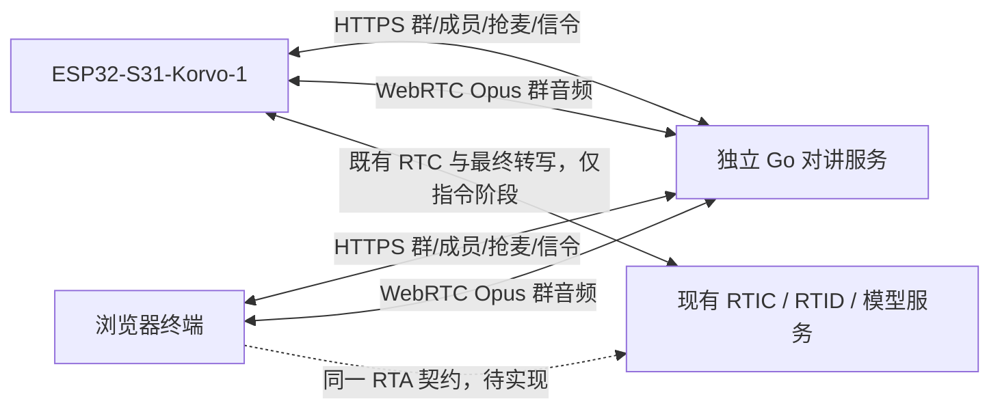

# 对讲架构草案

状态：Proposed。只记录已确认职责与待验证路线，不宣称实现完成。

## 职责与数据流

对讲服务权威管理群、成员资格、当前群、发言权和音频转发。媒体只从当前群获权成员转发给同群其余成员；服务端必须门控，不能仅依靠终端静音。群语音不进入模型。无需修改 miku-rti 或 mikud-live。

RTA 沿用原 RTIC 建会话、短期 RTC token、offer/answer 和 stop 接口；实际 model_profile/role_profile/voice_profile 决定模型能力。不会从“灵矽应用”措辞推定强制 Provider/WSS 或额外 PCM 链路。

## 生命周期与边界

任意终端只有一个当前群；加入群的成员资格与当前群分离。PTT 使用短期租约，过期、断线和切群必须释放。客户端在后台获权后才发音，服务端也独立核验权限。接收侧切群清除旧音频，不能将旧群排队帧带入新群。

板端沿用单 Peer 资源约束，群与 RTA 串行切换的路线需要真机验证。最终转写回调仅复制并投递带会话代次的事件；lifecycle worker 执行 stop、HTTP 切群确认和重连。重复/迟到事件不触发第二次切群。未知请求结果先查服务端状态，再恢复后台确认的当前群。

服务端切群命令只接受有限句式与已授权的唯一群名，未知、歧义、无权限一律不切。终端显示成功需要切群 ACK 与目标群 RTC 可用两个条件。失败恢复到未按麦状态。

## 首日需要实证的风险

1. Pion 服务与 esp_peer 1.5.1 在 ESP32-S31 上的 Opus/SDP/ICE 兼容与双向实音频。
2. 现有实际 RTA Profile 的最终用户转写是否可稳定获得，以及指令模式如何取消欢迎语。
3. 群 Peer 释放 → RTA → 群 Peer 重建的停顿、失败恢复与内部 SRAM 峰值。
4. 开发网络的 UDP 可达性、浏览器 HTTPS/localhost 麦克风权限与板端证书信任。

这些风险尚无本项目硬件测试证据。先实现局域网可演示闭环，公网拓扑与 TURN 根据实际网络验证决定。

## 实施与分工

戴伟为项目负责人及验收人；Codex 在专用仓库内辅助实现、测试和文档维护。先完成群服务/浏览器与板端双向实音频，及 RTA 最终转写两条关键路径，再串联切群。每次变更保留 PR/提交记录。不得把本项目代码写入两个参考仓库。
