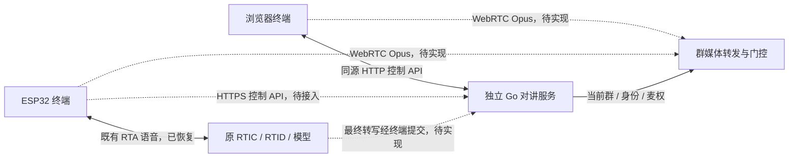

# 声路同行架构

产品范围见 [product.md](product.md)，实际证据见 [acceptance.md](acceptance.md)。架构分三条链路：控制面决定群和发言权，媒体面传群音频，RTA 指令链路取得用户主动发出的语音命令。当前开发从无板控制面开始。

## 组件与边界



实线表示已有基础或本切片建设范围；虚线为后续接入，不能视为已通过。媒体模块计划与控制面同进程，图中分开表示职责，不要求额外部署服务。

| 组件 | 负责 | 不承担 |
| --- | --- | --- |
| Go 控制面 | 身份、建群/口令入群、成员资格、当前群版本、切群终态、麦权租约 | 不凭模型回复授权，不相信终端自报成员 ID |
| 浏览器 | 发起人入口、成员操作、显示权威状态、请求代次与资源清理 | 不自行决定群权限或切换成功 |
| 板端 | Wi-Fi/触屏/音频、PTT、单 Peer 生命周期、主动语音指令 | 不新增行业实体，不保存服务端权限真相 |
| 群媒体模块（待实现） | 校验当前群与有效麦权，转发给同群其他接收者，限制队列并清理旧帧 | 不将普通群音频送给模型 |
| 现有 RTA | 主动语音阶段的最终转写；后续受限需求推荐 | 不执行入群、授权或切群，不承担群音频路由 |

不需要修改 `miku-rti` 或 `mikud-live`。保留固件内部 `rti_*` 名称、NVS 和旧接口兼容；板端可见应用名为「声路同行」，技术标识与品牌文案分别维护。

## 第一切片：本机控制面

具体接口以 [002-control-api.md](specs/002-control-api.md) 为唯一契约，避免在架构里重复字段。

```text
server/cmd/intercom/             启动、监听地址、状态文件配置与退出
server/internal/control/        权威状态、切群终态、麦权状态机与时钟注入
server/internal/persist/        独占文件锁、原子快照
server/internal/httpapi/        鉴权与边界校验、静态文件白名单、JSON API
server/internal/httpapi/web/     同源页面与浏览器状态测试
```

入口组装 persist → control → httpapi，状态层通过 Saver 接口写入快照，测试可注入保存失败与时钟。状态变更在同一互斥区内校验和提交，保存成功才发布新状态；HTTP 层不另存一份权限状态。

Go 标准库单进程服务，默认只监听本机；浏览器和 API 同源。终端随机凭据用于鉴权，群短口令只用于取得成员资格。快照保存身份摘要、群、成员、当前群版本与切群操作结果，成功落盘后才 ACK；麦权与限流不跨服务重启。单实例使用同一数据目录，数据文件不进 Git。多实例、账号体系、撤权管理与公网部署另立切片。

已加入群与当前群分离：第一群自动进入，加入第二群不打断当前群，创建者自动成为成员。切换用 expected_version 和 operation_id 防止旧请求晚到生效；重复相同操作只返回原终态。结果不明时重试同一操作直到终态，不能依据一次当前群快照推断不存在待执行请求。状态返回成员总数，presence 尚未实现，不能标成在线人数。

PTT 申请、续租、释放绑定终端、当前群版本、本次按下标识与服务启动代次，申请有固定生效期限。群忙不排队；松手立即退出持有并取消申请；迟到授权不能让终端重新按下；过期、切群与重启释放麦权。演示只显示控制授权，没有采集或传输音频。

## 第二切片：浏览器群音频

候选方案为每终端单 WebRTC Peer、一条上行和一条下行 Opus 音轨，先以独立浏览器验证，再验证板端。参考示例中可借鉴 ICE gathering、Opus 协商、权限申请、代次检查和资源清理；`session.update`、`oai-events`、Provider 轮次、PCM/WSS 与音色不是群媒体协议。

实现前补齐媒体契约：鉴权与控制连接绑定、SDP/ICE、Opus 参数、发言人变化时 RTP 序号/时间戳/SSRC、RTCP、慢接收端队列上限、旧群清空和断线处理。不能简单切换 RTP 包源便宣称播放连续。服务端必须独立门控，只有当前群获权成员的有效租约可转发；终端静音不能代替该检查。

先在 localhost 验证浏览器双向实音频、一对多与跨群隔离，再决定局域网 HTTPS、UDP 可达性和 TURN 配置。媒体可用需听测、浏览器统计与服务端隔离证据，控制 API 成功不等于可对讲。

## 第三切片：板端与语音切群

板端受单 Peer 资源约束，候选路径：群 Peer 释放 → RTA 取最终用户转写 → 提交控制面切群 → 停止 RTA → 按确认的当前群重建群 Peer。最终转写回调只复制并投递带指令代次的事件，由 lifecycle worker 执行 HTTP、stop 和重连，不在接收任务中关闭自身。指令阶段需抑制欢迎语。

首版只匹配有限句式中的明确已授权群名，未知、歧义、无权限不切。一次指令只提交一个操作；重复、过期或旧 RTA 会话结果无效。提交前可取消，提交后等待操作终态；后台已进入目标但 RTC 失败时显示“目标群连接失败”，不能猜测回到原群。权威 ACK 与目标群媒体可用同时满足，才显示“可以对讲”。所有恢复都回到未按麦状态。

原 RTA 会话创建、回复与最终转写已有真机证据；群 Peer 与 `esp_peer 1.5.1` 的 Opus/SDP/ICE 兼容、释放重建耗时与 SRAM 峰值、欢迎语关闭及板端证书信任仍需之后接板验证。本轮不操作板子。

## 需求推荐增强

在明确群名切换可靠后，给已加入且仍有权限的群补可选职责简介。模型只用本次主动需求与授权候选集推荐，群职责和模型输出均按不可信参考处理。用户确认时服务端重新核验目标、权限、有效期，再复用同一切群接口。

候选集版本、推荐有效期和单次消费需另补契约；实际 Profile 是否支持 tools 或可验证的结构化结果尚未确认。没有可靠结果、未确认、过期或失权均不切。增强项不阻塞基础群对讲。
