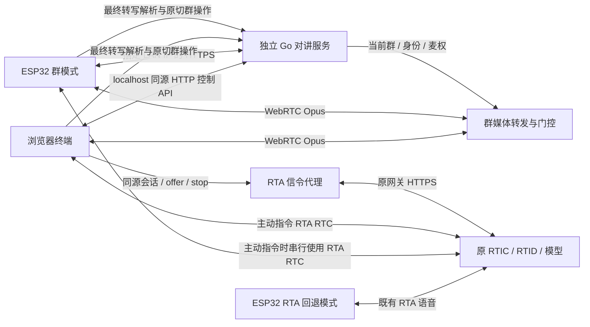
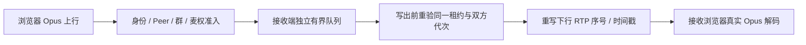

# 声路同行架构

产品范围见 [product.md](product.md)，实测范围见 [acceptance.md](acceptance.md)。控制面决定群与发言权，媒体面传普通群音频，RTA 取得用户主动发出的群名指令。[006 首版](specs/006-first-version.md)已随 PR #12 合并：板端口令入群、串行语音指令、浏览器本地 RTA 代理和首次运行工具。代码完成与人工听测分别记录。

## 组件与边界



图表示代码路径，不替代独立验收。群模式和原一对一应用由 Kconfig 选择；群模式中的主动指令仅串行借用同一 RTA Peer，不启动原应用控制器。媒体模块与控制面同进程，不要求额外部署服务。

| 组件 | 负责 | 不承担 |
| --- | --- | --- |
| Go 控制面 | 身份、建群/口令入群、成员资格、当前群版本、切群终态、麦权租约 | 不凭模型回复授权，不相信终端自报成员 ID |
| 浏览器 | 发起人入口、成员操作、显示权威状态、请求代次与资源清理 | 不自行决定群权限或切换成功 |
| 板端 | Wi-Fi/触屏/音频、PTT、口令入群、主动语音指令与单 Peer 生命周期 | 不新增行业实体，不保存服务端权限真相 |
| 群媒体模块 | 校验当前群与有效麦权，转发给同群其他接收者，限制队列并清理旧帧 | 不将普通群音频送给模型 |
| 现有 RTA | 主动语音阶段的最终转写；后续受限需求推荐 | 不执行入群、授权或切群，不承担群音频路由 |

不需要修改 `miku-rti` 或 `mikud-live`。保留固件内部 `rti_*` 名称、NVS 和旧接口兼容；板端可见应用名为「声路同行」，技术标识与品牌文案分别维护。

## 第一切片：本机控制面

具体接口以 [002-control-api.md](specs/002-control-api.md) 为唯一契约，避免在架构里重复字段。

```text
server/cmd/intercom/             启动、监听地址、状态文件配置与退出
server/internal/control/        权威状态、切群终态、麦权状态机与时钟注入
server/internal/persist/        独占文件锁、原子快照
server/internal/media/          Pion Peer、信令代次、逐包门控、RTP 续接与有界队列
server/internal/httpapi/        鉴权与边界校验、静态文件白名单、JSON API
server/internal/lan/            显式设备 LAN 配置、地址与证书校验
server/internal/httpapi/web/     同源页面与浏览器状态测试
```

入口组装 persist → control → media → httpapi，状态层通过 Saver 接口写入快照，测试可注入保存失败与时钟。状态变更在同一互斥区内校验和提交，保存成功才发布新状态；HTTP 层不另存一份权限状态。

控制面使用 Go 标准库，媒体面使用 Pion，同一进程默认只监听本机；浏览器和 API 同源。终端随机凭据用于鉴权，群短口令只用于取得成员资格。快照保存身份摘要、群、成员、当前群版本与切群操作结果，成功落盘后才 ACK；麦权与限流不跨服务重启。单实例使用同一数据目录，数据文件不进 Git。多实例、账号体系、撤权管理与公网部署另立切片。

已加入群与当前群分离：第一群自动进入，加入第二群不打断当前群，创建者自动成为成员。切换用 expected_version 和 operation_id 防止旧请求晚到生效；重复相同操作只返回原终态。结果不明时重试同一操作直到终态，不能依据一次当前群快照推断不存在待执行请求。状态返回成员总数，presence 尚未实现，不能标成在线人数。

[007](specs/007-group-purpose.md)为群记录增加可选职责，并由原授权群目录提供给浏览器；名称/职责筛选只发生在列表显示层，仍复用手动切群。原设备 HTTPS 入口省略职责字段，以保持固件目录响应大小。职责只作纯文本，当前不交给 RTA；后续语义推荐需先验证模型能力，再定义后台候选快照与原子确认事务。

[008](specs/008-product-ui.md)调整浏览器与板端呈现。浏览器添加群组面板有本地 UI 门禁：打开先同步取消发言，拒绝迟到授权和背景新动作；已提交请求、释放与恢复继续按原协议完成。关闭面板只解除该门禁，不重建媒体或自动按麦。板端调整 LVGL 布局和字体，控制器、媒体及持久操作契约保持原有实现。

PTT 申请、续租、释放绑定终端、当前群版本、本次按下标识与服务启动代次，申请有固定生效期限。群忙不排队；松手立即退出持有并取消申请；迟到授权不能让终端重新按下；过期、切群与重启释放麦权。S1 验收只覆盖控制授权；S2 在同一麦权语义上接入下述音频链路。

## 第二切片：浏览器群音频

具体接口以 [003-browser-media.md](specs/003-browser-media.md) 为准。每身份一个 Peer、一条上行与一条下行 Opus 音轨，服务端使用固定 Pion WebRTC v4.2.23。HTTP 完整交换已收集 ICE 的 SDP；媒体通过本机 UDP，当前无外部 STUN/TURN、混音或转码。Peer 固定绑定身份、服务启动代次、当前群与版本，切群必须关闭旧 Peer 并重建。



控制层保留唯一权威状态和内部媒体绑定，不依赖 Pion。媒体包入队与写出均核验源/目标当前群版本、活动 Peer 和源租约；未绑定 Peer 的旧控制租约不能放行音频。成功切群、松手、租约到期和旧连接失效使排队帧不再具备写出权限，不能依赖控制 API 轮询才停发；持久化失败不改变旧群权限。网络写入与等待式 Peer 清理在控制锁和 Pion 回调之外执行。

每接收端独立 Track、writer 与受包数/字节/年龄约束的队列。换发言人时续接独立下行 RTP 时间轴，剥离源扩展头；持续读取 RTCP、发送必要报告，不使用可在撤权后重发旧声音的 NACK 缓存。空闲生成合法 Opus 静音以完成首次播放和维持时间轴；因此仅有 RTP 包/字节增长不能证明有人讲话。

客户端 AudioClient 与控制状态代次分开。显式启用后申请麦克风，只有媒体就绪、获权 ACK 且仍按住时才打开源 track；松手先同步静音。autoplay 被阻止时显示显式开始收听，不能误报可对讲。切群、身份变化、隐藏、离线和重启均关闭旧媒体并清除播放入口；确认后恢复为未按麦。

门控不能撤回已进入网络或浏览器抖动缓冲的尾音；普通 RTP 也不携带每次按下标识，不能承诺绝对零尾音。旧群 Peer 与播放入口绝不作为新群连接复用。诊断用真实远端 PCM 与 Opus 统计区分有效声音、静音与尾音，并分别记录同页三终端和独立页面验证。

默认入口和 ICE 候选仍限 localhost/回环。S3 仅在完整显式配置后增加下述指定 LAN 入口，不把本机 ICE 证据外推到板端或公网，也未接入 TURN。

## 第三切片：板端群接入（首切片数值已通过）

具体增量以 [004-device-lan.md](specs/004-device-lan.md) 为准。默认固件启用 `CONFIG_MIKU_INTERCOM_DEFAULT_MODE`，使用群控制/媒体接口；缺少配置时等待 USB 配置和显式启动，不自动创建 RTA Session。关闭该 Kconfig 项并重新构建，才使用原 RTA 应用及 `rti_auth` 凭据；两条链路不并存。

服务默认只监听 loopback HTTP。设备入口须同时提供 `-device-addr`、证书、私钥及 UDP 端口上下界，额外监听一个本机活动网卡上的 RFC1918 IPv4 HTTPS 地址。设备请求须使用精确 IP:port Host、TLS 1.2+ 且不带 Origin；不信任转发头，不开放 CORS、静态页、诊断或匿名身份注册。身份与 TLS 配置通过本机入口和 USB 初始化；群口令可在板端键盘输入。媒体只额外发布所选 LAN IP 的候选并保留 loopback，使用限定 UDP 范围；候选过滤不等于每个底层 socket 都只绑定该地址，无公共 STUN/TURN 或公网接入。

USB 工具只从私有 JSON 文件读取 `server_url`、`ca_pem`、`device_id`、`token`、可选的 `group_code` 字段，压缩后的 ASCII JSON 总计不超过 2000 B，存入独立 `intercom` NVS。板端验证 CA 链、IP SAN/主机名和有效期，不允许跳过 TLS 校验。开发证书使用本机短期 CA 和匹配 IP SAN；私钥留在本机，板端仅取得 CA，浏览器仍用 localhost，不安装系统根证书。

联网后启动 SNTP 校时；无外网时保留 USB `--sync-time` 提供 UTC。有效时钟尚未建立时等待，不绕过证书有效期。正常配置和仅应用区刷写保留原 Wi-Fi、`rti_auth` 与音量设置。群模式遇到 NVS 无空页或版本不兼容时停止并要求显式修复，不自动清除 NVS；RTA 回退模式仍保留原异常处理，不能将其视为相同保证。

群会话由 lifecycle worker 复用一个 HTTPS client handle，在同一身份/配置内切换 GET、POST、PUT、DELETE；每次重设方法、URL、头与请求体，完成后解绑请求体和响应指针，再释放临时内存。只有完整且可持久连接的成功响应保留 handle，失败、服务端关闭、停止或配置替换会清理。HTTP helper 不自动重放写请求；005 的切群 worker 只按日志查询并显式重放同一固定操作。

群模式约 24.2 KB 的非 DMA 音频工作区（采集/mono/累积缓冲、播放 PCM/reference/包缓冲）显式分配到 PSRAM，无 internal heap fallback，分配失败走清理。I2S 驱动缓冲仍使用 DMA，AEC 的 DMA_ATTR 数组仍在内部内存；这不代表全部音频内存迁入 PSRAM。RTA 模式这些工作区原有的 `malloc` 路径未改。

板端复用 Opus/AEC 与单 Peer 资源，普通群音频使用 PTT 与源发送门；只有显式进入指令阶段才建立 `oai-events`，不发欢迎请求并禁止模型音频播放。按下仅在 Peer 就绪、匹配群版本/启动代次的麦权 ACK 返回且仍按住时发送；松手或取消先同步关门，再释放，发送前重验本地租约。恢复只回到未按麦。配置、校时、控制状态、Opus/PCM 双向数值传输与人工听测分别记录。PR #10 首切片历史镜像的浏览器→板端窗口为 3010 ms，板端远端累计峰 0.519934；板端→浏览器 PULSE6 发送 299 包，浏览器远端累计峰 0.0075，松手后发送计数维持 299。120.26 秒正常观察为 1 次 TLS 连接、0 失败；计划服务中断另产生 7 次连接错误，恢复后为新 epoch/Peer、同群同版本、未按麦且 TX 为 0。它们支持首切片数值与短时恢复结论，不能称为全程零错误或长期稳定性/听感验收，详见[最终证据](evidence/2026-10-24-device-group.json)及 [acceptance.md](acceptance.md)。

### 已加入群手动切换（005，本轮数值与软重启恢复已验证）

[005](specs/005-device-multigroup.md) 复用 002/003，不新增另一套权限。板端显示已加入群下拉列表，选择本身不提交，点击确认才请求切换；当前群名称始终来自后台确认的 state。展开列表取消当前发言。目录未知、过期、切换中或媒体未就绪时禁用 PTT，旧 `view_generation` 的点击拒绝。目录及 UI 深拷贝使用 PSRAM，最多 128 群；超限或非法条目整体失败，不静默截断。

接受切换时同步暂停旧 Peer 的 TX、RX 入队与 PCM 播放准入，再由 worker 释放麦权和关闭旧 Peer。已进入网络或 I2S/DMA 的尾音不能撤回。首次 PUT 前将固定 `operation_id`、目标、`expected_version` 及 `server_url`/`device_id` 绑定写入独立 NVS 日志并 commit；不存 Token/CA。Stop、断网、服务或板端重启保留待确认操作；先查询，404 才按原载荷重放，不生成新操作替代。配置绑定不匹配时保留日志并暂停，要求恢复原服务与身份。

操作结果不明时不建任何群媒体。验证同一操作终态后再取最新 state，日志清理成功后才按该当前群重建单 Peer，并保持未按麦；拒绝也按最新状态恢复，不猜测回原群。USB 目录和切群命令经过同一控制器；`REQUESTED` 仅表示受理，不能证明切换完成。

本轮三群 A/B/C 使用一个浏览器的合成 440 Hz，播放静音。同 A/B 时板端 RMS 分别为 0.071842/0.071816；板 B 听 A、板 C 听 B 的累计 remote_rms_peak 均为 0。持麦 A→B 后 pressed/held=false，新 Peer TX=0；十次连续切换 version 3→13，每次 ready、未按麦且 TX=0。SWITCH+STOP 保留 NVS pending，软重启读回同操作号，START 确认至 A/version 14，清理后再次软重启 pending=false；两次软重启不是实际断电测试。用户仅人工确认当前群、下拉及按钮显示，切换矩阵主要经串口同控制器驱动。

[本轮多群证据](evidence/2026-10-24-device-multigroup.json) 与 PR #10 历史证据独立。16 次 Peer start/close 无 panic，但不外推长期稳定性、完整触控或听测。当前 HTTP 统计将每个新操作查询得到的预期 404 计为失败，本轮 13 次操作相应有 13 次非 2xx，不能称为零 HTTP 失败。Mac 独立开串口会复位，本轮使用一条长串口会话；工具不会自动校时或连接，未知目录拒绝切换。主机入口、串口前提与局限见[开发指南](development.md)。

## 第四切片：主动语音切群

板端路径：退休群 Peer → RTA 首次最终用户转写 → 后台只读解析 → 确认 RTA stop → 复用 NVS 切群日志 → 按权威当前群重建群 Peer。浏览器先持久提交/查询切群，再确认 RTA stop，随后恢复群 RTC；期间门控不会重建群 Peer。最终转写回调只复制并投递带指令代次的事件，由 lifecycle worker 执行 HTTP、stop 和重连，不在接收任务中关闭自身。命令模式关闭自动回复、不发欢迎请求且禁止播放模型音频。

首版只匹配有限句式中的明确已授权群名，未知、歧义、无权限不切。一次指令只提交一个操作；重复、过期或旧 RTA 会话结果无效。提交前可取消，提交后等待操作终态；后台已进入目标但 RTC 失败时显示“目标群连接失败”，不能猜测回到原群。权威 ACK 与目标群媒体可用同时满足，才显示“可以对讲”。所有恢复都回到未按麦状态。

原 RTA 会话创建、回复与最终转写已有真机证据，不能替代 S3 群接入验收。当前 `esp_peer 1.5.1` 组合已有 S3 双向数值与三次 Peer 生命周期无 panic 的证据；资源、耗时与可靠性结论仅限记录的测试范围。本分支生产流程回归与真实链路结果分别按 006 验证。浏览器代理使用显式私有配置，固定 origin 或受限数字节点域/端口二选一，RTC路径绑定原session，拒绝重定向；会话日志记录句柄与清理状态，不保存Key、短期Token、SDP或转写。

## 需求推荐增强

在明确群名切换可靠后，给已加入且仍有权限的群补可选职责简介。模型只用本次主动需求与授权候选集推荐，群职责和模型输出均按不可信参考处理。用户确认时服务端重新核验目标、权限、有效期，再复用同一切群接口。

候选集版本、推荐有效期和单次消费需另补契约；实际 Profile 是否支持 tools 或可验证的结构化结果尚未确认。没有可靠结果、未确认、过期或失权均不切。增强项不阻塞基础群对讲。
