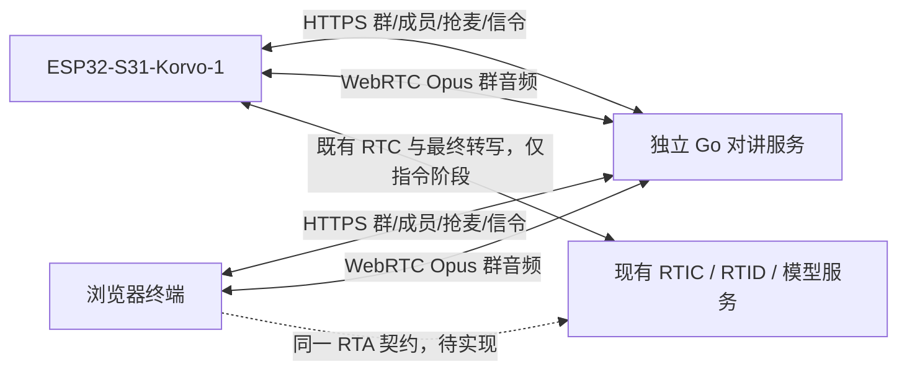

# 对讲架构草案

状态：Proposed。产品定位为小组即时协作，不限定车队；以 docs/product.md 为产品流程来源。本轮继续规划，未新增实现。

## 职责与数据流

对讲服务权威管理群、成员资格、当前群、发言权和音频转发。媒体只从当前群获权成员转发给同群其余成员；服务端必须门控，不能仅依靠终端静音。群语音不进入模型。无需修改 miku-rti 或 mikud-live。

RTA 沿用原 RTIC 建会话、短期 RTC token、offer/answer 和 stop 接口；实际 model_profile/role_profile/voice_profile 决定模型能力。不会从“灵矽应用”措辞推定强制 Provider/WSS 或额外 PCM 链路。

## 生命周期与边界

任意终端只有一个当前群；加入群的成员资格与当前群分离。PTT 使用短期租约，过期、断线和切群必须释放。客户端在后台获权后才发音，服务端也独立核验权限。接收侧切群清除旧音频，不能将旧群排队帧带入新群。

板端沿用单 Peer 资源约束，群与 RTA 串行切换的路线需要真机验证。最终转写回调仅复制并投递带会话代次的事件；lifecycle worker 执行 stop、HTTP 切群确认和重连。重复/迟到事件不触发第二次切群。未知请求结果需查询对应请求终态与当前群；只有请求已完成或后台保证不再生效后，才能恢复，不能在仍可能迟到生效时依据一次当前群快照恢复。

服务端切群命令只接受有限句式与已授权的唯一群名，未知、歧义、无权限一律不切。终端显示成功需要切群 ACK 与目标群 RTC 可用两个条件。失败恢复到未按麦状态。切群明确被拒绝时恢复原群；结果不明先确认对应请求终态；后台已切成功但目标 RTC 失败时显示目标群连接失败并重试，不能猜测回到原群。提交前允许取消，提交后只能等待终态确认。

## 按需求推荐协作群（增强，尚未实现）

群可选保存职责简介。后台按当前成员资格提供候选群；RTA/模型仅基于本次明确触发的需求和必要简介提出建议，不接管当前群。职责文本和模型输出均为不可信参考数据。不能预设实际 Profile 具有 tools 或结构化输出能力；模型接入方式和可验证输出需实测后确定。

设备展示候选群及理由，用户明确选定并确认后，后台重新校验推荐是否有效、成员资格和目标群，再使用同一套切群请求、幂等、终态与媒体恢复流程。未确认、无匹配、结果含糊、过期或失权均不切；提交后的终态规则不因推荐来源改变。普通群语音仍不经过模型。

增强项的具体候选群版本、推荐有效期、确认与过期接口尚未冻结，必须先补齐契约和实际模型证据。它不改变首版按群名切换的范围。

## 首日需要实证的风险

1. Pion 服务与 esp_peer 1.5.1 在 ESP32-S31 上的 Opus/SDP/ICE 兼容与双向实音频。
2. 现有实际 RTA Profile 的最终用户转写是否可稳定获得，以及指令模式如何取消欢迎语。
3. 群 Peer 释放 → RTA → 群 Peer 重建的停顿、失败恢复与内部 SRAM 峰值。
4. 开发网络的 UDP 可达性、浏览器 HTTPS/localhost 麦克风权限与板端证书信任。

这些风险尚无本项目硬件测试证据。先实现局域网可演示闭环，公网拓扑与 TURN 根据实际网络验证决定。

## 实施与分工

戴伟为项目负责人及验收人；Codex 在专用仓库内辅助实现、测试和文档维护。先完成群服务/浏览器与板端双向实音频，及 RTA 最终转写两条关键路径，再串联切群。每次变更保留 PR/提交记录。不得把本项目代码写入两个参考仓库。

## 进入实现前需补齐的契约

- 终端身份与成员资格：口令入群后颁发何种凭据、如何保存和恢复、后台如何鉴权，不能用昵称或群名代替身份。
- 持久化：群、成员资格和当前群在服务重启后可恢复；终端重连必须重新核验。存储实现尚未选定。
- PTT：按下申请、获权才发送、释放与租约失效规则；不自动排队；抢麦与重试的代次标识。
- 切群：唯一请求标识、最终转写所属指令代次、幂等 ACK、操作终态及当前群版本查询、超时和音频清理时序。
- 群媒体：Opus/SDP/ICE 协商、后台收发门控、跨群隔离及慢接收端处理。
- 需求推荐（增强）：可选职责字段、已授权候选集及其版本、推荐有效期和单次消费、用户确认、模型输出校验与无匹配处理。

产品流程可以先审阅，并允许在隔离验证中测试最小 SDP/音频与 RTA 兼容性。公共与内部契约按对应功能切片，在该切片正式实现前写清并落实对应验证；U5 增强契约不阻塞 U1–U4 基础闭环。不把本文的建议当作已实现协议。
