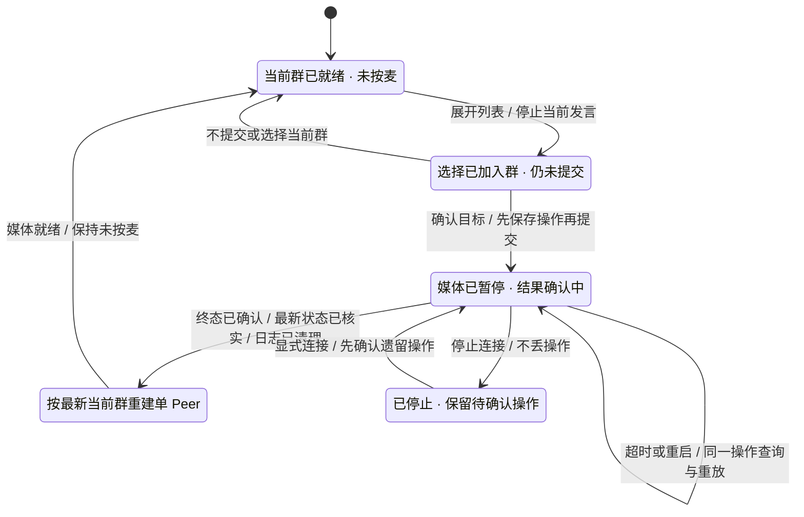

# S3 板端已加入群切换

状态：已实现并完成一板一浏览器的多群数值与软重启恢复验证，2026-10-24。延续 [002](002-control-api.md)、[003](003-browser-media.md) 和 [004](004-device-lan.md)，不改服务端切群契约。首版提供已加入群列表及显式切换；板端口令键盘与语音切群后续实现。

## 列表与意图

当前群只显示后台确认的状态，下拉选择本身不执行；点击切换才提交。展开列表取消当前发言。无已知目录、目录过期、切换中或媒体未就绪时禁用 PTT。名称沿用完整中文 16px 字库；列表及 ID 深拷贝使用 PSRAM，最多 128 条，超限或非法条目整体报错，不静默截断。服务端只列本身份已加入群，列表代次不匹配的点击拒绝。

## 先停媒体，再确认切换

接受切群意图时同步取消 PTT，并暂停旧 Peer 的发送、接收入队及 PCM 播放准入；已进入网络或 I2S 的尾音不能撤回。异步 worker 释放麦权、关闭旧 Peer，再执行切群。同一时刻最多一个切群操作；终态不明期间不得建立任何群媒体，不能接受另一个目标覆盖它。

操作包含固定的随机 operation_id、目标 group_id 和 expected_version。首次 PUT 之前，将绑定 server_url/device_id 的操作日志写入独立 NVS key 并 commit；失败不发请求。超时、断网、停止/重连、服务重启及板端重启都保留日志。恢复时先查同一操作，404 则按原载荷重放，不能生成新 ID 或刷新预期版本。身份绑定变化时保留日志并明确报错，不把旧操作重放给新身份。

验证 applied/rejected 终态及其原始载荷，再获取最新权威 state；操作终态内的历史 current_* 不覆盖最新状态。日志清理成功后才恢复最新当前群媒体，保持未按麦。业务拒绝时也按最新 state 恢复；不猜测返回原群。低版本状态、旧列表点击、迟到授权或旧媒体回调不得恢复发送。

## 验证范围

主机回归驱动实际生产意图、操作解析、日志与媒体准入代码，覆盖同操作号重试、拒绝、迟到响应、停止/恢复和边界输入。真机验证一板与浏览器的多群状态、持麦切换、至少十次 Peer 重建、跨群 PCM 隔离与最终资源清理。串口驱动复用 UI 控制器入口，不直接改后台状态来冒充板端切群。播放保持静音，不保存录音，不计为人工听测。

## 状态交互

日志保存的本地错误只有在确认没有待处理日志且未发出 PUT 后才可结束该意图。对保存或清理结果不明的错误保持暂停；不得以“保存失败”猜测未落盘。配置变更遇到旧身份日志时提示恢复原配置，不能自动清除日志。
