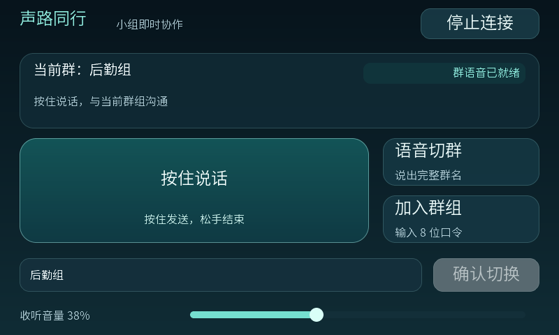

# 正式产品界面与操作

2026-10-25。延续[产品定义](../product.md)、[002 控制契约](002-control-api.md)、[003 媒体契约](003-browser-media.md)、[006 首版语音指令](006-first-version.md)和 [007 群职责](007-group-purpose.md)。本切片基于 PR #13 的职责数据单独评审，不改变身份、群、发言权、持久切群或音频协议。

## 产品目标

用户进入主界面即可判断当前群、连接是否可用、当前能否发言，以及下一步可做的操作。借鉴 Apple 当前 Liquid Glass 对导航/操作层和内容层的区分，保留声路同行自身的色彩与图形识别。

- 浏览器采用跟随系统的浅/深主题。玻璃材质集中用于导航与操作区域，主要内容保持清晰；背景模糊不可用、透明度降低、高对比和减少动态效果时仍可读、可操作。
- 板端保留 800×480 触屏，使用轻量填色、圆角和高光形成同样层级，不引入实时背景模糊、大幅背景图或额外音频内存分配。
- 正文、状态、按钮和焦点均有清晰对比；新界面主操作有效触点至少 44×44，滑块可用扩大命中区域满足。浏览器输入至少 16px，主要正文至少 14px；320px 窄屏与桌面均不丢失关键操作。
- 状态不只依靠颜色。文本、形状和按钮可用性共同表达未连接、连接中、就绪、申请、发言、忙、恢复和失败。

设计参考：[Apple 2026 Design guide](https://developer.apple.com/wwdc26/guides/design/)、[Materials](https://developer.apple.com/design/human-interface-guidelines/materials)。Web 与 LVGL 实现为本产品的适配，不宣称调用 Apple 原生材质框架。

## 浏览器信息层级

主界面聚焦当前群、真实连接/发言状态和 PTT。已加入群目录保留名称、职责及本地筛选，仍由用户主动进入；成员数表示已加入人数。

建群与口令入群进入显式的次级任务面板。空群时有清楚的加入/创建入口；成功后保留实际结果、收起任务表单并清空成功提交的输入，失败保留输入并显示可恢复的原因。创建后的口令只在本次成功结果中展示，复制失败时保留可手选文字。关闭任务面板或按 Esc 返回时，焦点有明确去向。

音频连接、收听静音、播放重试、语音切群与取消/继续恢复保持独立且可发现。主流程采用用户用语；请求终态、Peer、媒体代次等内部术语留在开发文档和诊断中。状态等待时说明用户需要等待、重试或重新按下，不误报已连接。

| 实际状态 | 用户反馈与操作 |
| --- | --- |
| 无身份 / 无群 | 输入称呼开始；建群或输入口令加入；PTT 不可用 |
| 群目录尚未确认 | 显示正在获取或加载失败；取得空目录后才显示无群和创建/加入提示 |
| 未启用音频 | 主动连接对讲后才请求麦克风；不自动采集 |
| 音频连接中 / 控制状态待确认 | 显示连接或恢复中，保留明确停止/重试入口，PTT 不可用 |
| 远端播放受阻 | 显示需要开始收听，主动重试播放；不误报完整媒体就绪 |
| 媒体与控制就绪、无人持有 | 明确可发言，按住后仍须等待授权 |
| 正在申请 / 自己获权 | 显示申请中 / 正在发言；松手先停发，再释放 |
| 他人获权 | 浏览器按后台快照显示发言者，忙时不排队自动开麦；不据此宣称观测到人声 |
| 切群或语音会话结果未明 | 显示正在完成切换/恢复，保留原操作确认；不以列表选择或识别文本代替当前群 |

常驻群目录、本地筛选与滚动定位仅影响呈现；不会因目录可见而永久禁用对讲。

## 板端信息层级

当前群名称与候选群选择分别展示。连接/停止、语音切群、口令入群为明确按钮；PTT 为主操作，群目录确认与收听音量为次级操作。音量初始化、拖动实时调整、松手保存仍沿用已验证行为。

图由生产构造器与状态渲染函数在真实 LVGL 中绘制，群名和就绪状态来自测试 fixture；它展示布局，不作为物理屏幕或音频链路的验收。

命令弹窗保留准备、允许说群名、确认/恢复、结束与权威当前群，提交前取消与提交后等待继续区分。入群和 Wi-Fi 键盘锚点修复保持；长中文、最底行、确认/关闭触点不得被遮挡。固定主操作采用 24px 子集，逐字验证字形并保留字体许可；当前群名采用 20px/2bpp、与原 16px 字库相同的 GB2312 覆盖，实际群名成为主标题。字体不扩大为任意 Unicode 或 emoji 支持的承诺。

## 交互安全不变式

1. 打开建群/入群任务面板先同步取消 PTT，再阻止新申请和迟到授权。板端显式菜单边沿继续处理来自触屏或 USB 的按下；只改变视觉的状态发布不反向调用 PTT。
2. 面板关闭、Esc、失焦、隐藏、断线和重连始终保持未按麦。关闭面板只解除 UI 门禁，不调用 enable、创建 Peer 或恢复发送。
3. UI 门禁只限制新操作，不阻断已发生的释放、持久切群终态查询或 RTA 清理。未决操作继续使用固定 ID 和载荷，不回退成新请求。
4. 只有后台当前群已确认、媒体实际可用、身份仍归本标签且无未决操作，才呈现可发言。选中列表、拿到转写或 HTTP 请求已发送均不代表成功。
5. 保留普通页面的显式麦克风授权、松手/取消/失焦停发、隐藏清理和恢复未按麦；诊断工具仍独立，不将测试驱动放进主操作。
6. 不新增假在线数、模型建议、他人身份或未实现的设置。职责和群名始终纯文本展示，设备入口继续省略职责字段。

## 验证与交付

前端使用实际初始化与渲染代码的 DOM 回归，覆盖空群入口、面板/焦点/键盘、表单成功/失败、复制、未决状态、打开面板时迟到获权不恢复发送及关闭后不自动采集。核心控制与媒体状态回归继续执行。

板端使用真实 LVGL 构造器、字体、布局与指针命中测试，检查 800×480 主界面、长群名/弹窗、有效触点、静态字形、音量与旧键盘故障变体；可导出的帧缓冲图只作为合成状态的主机渲染证据。随后执行完整 IDF 构建与分区容量检查。

主机渲染、编译、Flash 校验、真实屏幕与浏览器交互分别记录；任何尚未完成的人工或硬件验收保持待办，不以 DOM 替身或图片替代。新 UI 不自动开启听测或追加 RTA 会话。实际结果与镜像标识统一记入[验收记录](../acceptance.md)。
