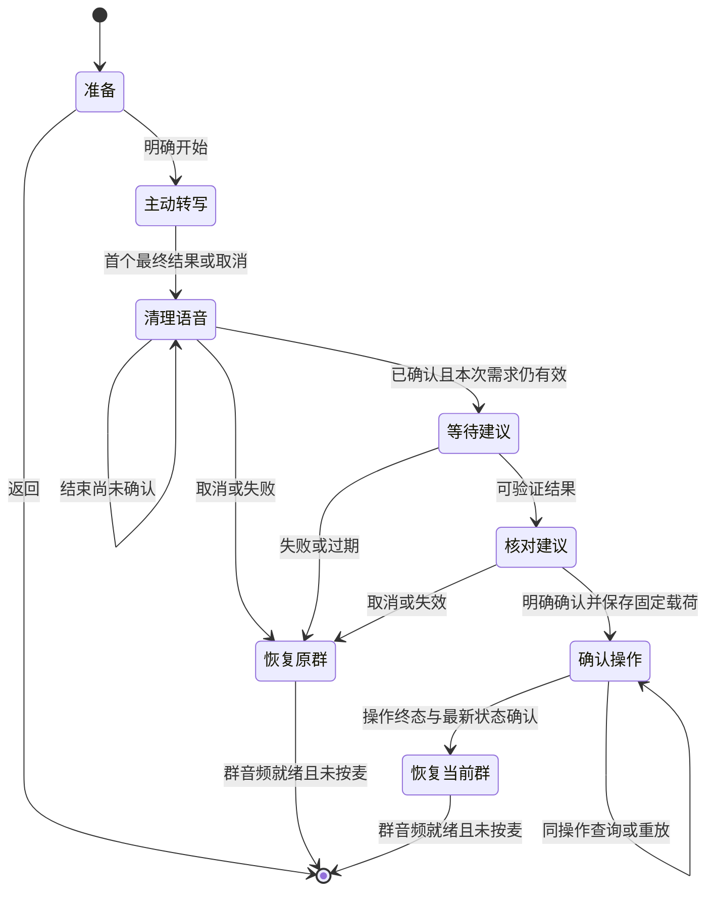

# S5：按主动需求推荐已加入群组

2026-10-25 更新：本规格的职责推荐规则不变。当前直接群名语音入口改用 [010](010-voice-target-review.md) 的目标核对与明确确认；下文“明确群名保持原路径”的叙述属于该增强之前的实现记录。

2026-10-25。基于 [007](007-group-purpose.md) 的独立增强切片。PR #17 先交付浏览器主动文本输入；后续在 main `9b3f5f4` 上补浏览器与板端的主动语音需求入口。群职责与本地筛选继续保留；它们不算模型推荐。切群、权限与媒体的权威契约仍为 [002](002-control-api.md)、[003](003-browser-media.md)、[006](006-first-version.md)。明确群名命令不改变原语义；新增入口的无板回归与实际语音、触控、媒体恢复分别验收。

## 能力门槛与数据边界

使用用户已批准的原 RTA 网关与现有 Profile，通过 RTC DataChannel 发送一次有界文本请求。不增加 Provider，不依赖 tools、function calling、强制结构化输出或置信度。原 RTA 的真实文本终态、纯文本请求与禁播放的验证证据单独保存；离线注入模型只验证软件契约，不能代替真实模型结果。

默认不启用模型推荐。只有显式配置并启用已验证适配器时 `available=true`；配置缺失、模型不可用、输出非法或远端清理未确认时明确失败，不使用关键词、Mock 或固定推荐兜底。普通群音频不进入推荐器；文字输入和文本模型阶段不打开浏览器麦克风、不播放声音或启动语音指令。独立“说出需求”入口明确触发一次转写，先完成采集及清理，再进入同一文本推荐阶段。

后台在唯一控制锁内从调用身份已加入且仍授权的群生成候选，按群 ID 排序。模型只获得本次需求、临时候选 ID、群名和可选职责，不取得身份凭据、群口令、真实群 ID、成员名单或其他群。在线状态和个人可接听能力尚未实现，推荐不代表有人在线、空闲或已经接听。

群名、职责、用户需求及模型输出均为不可信数据。适配器把它们作为数据编码，不执行其中的指令。后台拒绝未知候选和非法输出，页面用纯文本展示。模型只有建议权；没有入群、授权、切群或播放的执行入口。

候选提示策略 `direct-duty-v3` 先区分明确协作事项与强选、改格式、泄密或执行类操控。混合输入中保留仍清楚的真实事项；只有操控、信息不足必须猜测或没有直接对应职责时返回空建议。候选职责须直接覆盖用户明示的处理对象或检查要求，不因潜在成因、上下游或辅助关系扩大联系范围。用户主动要求排查某个假设时，可以按该检查事项匹配，但假设不作为已知原因。理由只说明职责能提供的协助范围，不替用户诊断故障或承诺在线/接听。提示约束的实际遵循仍按[固定质量评估](../evaluation/README.md)验证，不以措辞或离线 Fake 回复代替模型成绩。

对外说明策略为 `server-neutral-v1`。控制层继续严格校验模型 JSON 中的 `reason`，但丢弃该自由文本；只有合法授权候选通过原有校验后，API `reason` 才填写固定说明“模型建议联系该组，请核对群职责后确认。”。不拼接需求、群名或职责，不诊断故障、不扩写能力；未知候选或非法输出仍整体失败，不产生兜底建议。模型继续决定候选、顺序和空建议，选组提示未改变。

浏览器与板端分别展示“群职责（填写内容）”和“推荐说明”。职责保留原授权目录的填写内容，以纯文本呈现，服务端没有核验其真实性；固定说明也不证明模型选对了群。取消个性化理由是本轮防止扩写进入产品展示的取舍，不代表原模型的自由生成能力已变得忠实。API 字段、160 码点上限、授权、期限和明确确认契约保持兼容。

## 有界范围

- 需求：去除首尾空白后 1–512 个 Unicode 码点，合法 UTF-8，不含 Unicode Cc 控制字符。
- 候选：最多 32 群，完整 `{id,name,purpose?}` 数组 JSON 最多 16 KiB；超限整体拒绝，不静默截断候选。不以成员总数模拟在线能力。
- 一次模型调用使用 20 秒 context；适配器必须遵守该期限。失败后远端停止确认可另用独立的有界清理期限，页面 HTTP 等待上限为 35 秒。不能确认清理时不给出建议。
- 原始模型文本最多 4096 字节，严格解析唯一 JSON 对象 `{"suggestions":[{"candidate_id":"c00","reason":"简短理由"}]}`。属性名大小写必须完全一致，拒绝别名及其重复键。未知字段、重复 JSON 键、重复候选、额外 JSON、Markdown 包装、无效 UTF-8、非法候选均拒绝。
- 最多 3 条建议；理由 1–160 个码点，首尾无空白、不含 Cc。空数组表示无合适建议，不自动选择。
- 候选 ID 为本次排序后的 `c00`–`c1f`，精确映射到后台候选；实际群名和职责总是由后台补回，不采用模型自报群名。
- 推荐有效期从捕获候选快照起固定 60 秒，模型等待消耗这段期限，重试不延长。
- 每身份最多 1 个进行中的请求、8 条未到期记录；进程总计最多 256 条。新需求之间至少 5 秒。满额拒绝，不淘汰仍有效记录；过期已完成记录可回收。

## 浏览器与设备 API

继续使用原 Bearer 身份、禁止缓存、8 KiB JSON 请求体与未知字段拒绝。浏览器沿用本机同源/Host 门禁；设备 HTTPS 入口也提供下列端点，但必须通过原 TLS 1.2+、精确 Host、无 Origin、Sec-Fetch-Site 门禁及已有独立设备身份鉴权。设备入口不提供页面、CORS 或匿名注册。两种入口调用同一控制服务，不接收客户端候选或身份声明。

| 方法与路径 | 请求 | 结果 |
| --- | --- | --- |
| GET `/api/v1/recommendations` | 无 | `{available,reason}`；未配置时 `available=false` |
| POST `/api/v1/recommendations` | `{request_id,need,expected_version,server_epoch}` | `{recommendation}`；只生成建议，不执行切群 |
| PUT `/api/v1/recommendations/confirm` | `{recommendation_id,operation_id,group_id,expected_version,server_epoch}` | 与原切群相同的 `{operation,state}`，业务拒绝也返回持久终态 |

ID 均沿用 002 的 8–80 位 ASCII 字母、数字、下划线、连字符约束。身份仅由 Bearer Token 决定，不接收客户端候选或身份声明。

`recommendation` 为 `{recommendation_id,request_id,server_epoch,current_version,candidate_digest,expires_at,suggestions:[{group_id,name,purpose?,reason}]}`。摘要为按 ID 排序的完整授权候选 `{id,name,purpose?}` 数组 JSON 的 SHA-256 小写十六进制值；不包括会自然变化的成员总数与麦权。身份由服务器的记录所属关系绑定；版本与 epoch 防止旧状态跨切换、重启使用。追加成员资格不改变当前群版本，因此候选摘要必须独立比较。

POST 在锁内捕获快照，释放锁运行模型，再在锁内核对身份、当前群版本、完整候选摘要与期限。等待期间新增已加入群、群名/职责变化、撤权或切群都会拒绝过时结果。模型等待不阻塞 PTT、状态、入群或切群控制。模型错误不回显原始 Provider 错误或需求正文。

相同身份、相同 request_id 与相同完整载荷在记录有效期内重放时复用结果，不再次调用模型；进行中返回 `recommendation_pending`。相同 ID 换载荷返回冲突。过期完成记录可能回收，因此 POST 重试不承担永久去重保证；它没有切群副作用，确认操作的永久幂等性由下节保证。

## 明确确认与原子消费

用户先看到群、填写的职责与固定核对说明，自主选择后点击“确认进入”。推荐返回、列表选择、取消、过期、页面隐藏或模型声称成功都不能提交切群。客户端持久保存固定确认载荷后才首次 PUT，结果不明时继续查询/重放该操作；不能生成新操作号替代，也不能只查当前群就恢复媒体。

后台在同一控制锁和同一个持久快照事务内完成：

1. 若本身份已有相同 operation_id，先校验完整绑定并返回其已保存终态，再考虑当前期限、epoch、候选或权限。载荷不同返回 `operation_conflict`。
2. 若该推荐已由其他操作号留下终态，记录新操作 `rejected/recommendation_consumed`。
3. 校验推荐属于本身份、已完成且无模型错误、epoch 匹配、未到期、expected_version 等于推荐版本、目标仍有权限且确为本次建议之一、完整候选摘要未变。
4. 复用原切群实现重验当前版本与成员资格；持久保存推荐消费标识及原操作终态、当前群与版本。成功落盘后才发布状态并撤销旧群麦权/媒体绑定；保存失败不消费推荐、不改变当前群或麦权，重试同一载荷。

所有合法确认首次产生的业务终态（包括拒绝）都消费该推荐，避免同一建议换操作号反复尝试。新需求可以重新生成推荐。确认体格式错误、操作容量已满、持久保存失败不产生终态。原每身份 1024 条操作历史容量仍适用，不删除旧幂等记录。

`operation` 增加可选 `recommendation_id` 与 `recommendation_epoch`；仅推荐确认填写。旧手动/明确群名操作保持原字段集合，不能拿相同 operation_id 从推荐载荷改成普通切群。服务重启清空未消费推荐，不恢复模型结果；已保存确认终态可携带旧 epoch 原样重放。此前未到达的旧 epoch 确认保存为 `rejected/server_restarted`，此后迟到请求不会再执行。

新版本读取缺少推荐字段的旧快照。旧二进制会拒绝含新增操作字段的快照；升级前应保留一致旧快照，回滚二进制时使用对应旧快照，不删历史或静默降级。

## 终态与媒体恢复

确认继续采用 002 的 `applied/rejected` 终态和 GET `/operations/{operation_id}`。操作含执行完成时的当前群快照，`state` 是最新权威状态；旧终态不覆盖较新的当前群。取得操作终态、刷新最新 state、清除本地待确认日志后，才允许按原媒体期望重建群连接，保持未按麦。后台已切群但媒体失败时显示目标群和连接失败，不显示已可对讲。

浏览器不为文本请求本身建立另一个音频 Peer。确认切群时沿用原持久操作、PTT 取消、旧媒体退休、终态核实及恢复流程。未确认推荐失效不会改变后台当前群。明确群名语音切换继续走原有限解析，不额外套推荐确认；普通对讲继续直接转发。

## 验证与剩余验收

离线 Go 回归使用注入模型，覆盖仅已授权候选、无执行副作用、请求重放、严格输出、恶意数据、单次消费、并发消费、保存失败重试、丢响应后重放、过期/跨重启终态、跨身份、撤权、候选变化、当前版本变化、模型等待期间控制不阻塞、模型错误和取消、容量/频率/字节边界及 HTTP 门禁。浏览器回归检查理由纯文本、选择后明确确认、持久载荷与终态恢复，另保留真实模型验收。

本轮无板开发不开串口、不刷板、不采集麦克风、不播放声音、不调用真实模型网关。PR #17 的真实模型文本成功不等于新增板端交互、真实语音需求、实体触控、群音频或性能稳定性已通过，不以原明确群名切换的历史证据代替。

## 主动语音需求与板端入口

“语音切群”与“需求找组”是两个独立意图。前者仍只处理完整群名命令；后者主动采集一次需求，不能调用 `/voice/resolve` 或把最终转写直接当作切群目标。打开板端准备页只展示说明，点击“开始说需求”后才启动采集；浏览器也必须明确点击语音需求按钮。群对讲音频不会自动触发此流程。

共同前段为：同步停发并退休原群 Peer → 建立本次 RTA 转写会话 → 配置确认后才允许说话 → 接受本代次第一个最终转写并立即停采集 → 关闭本地命令 Peer、确认已知远端会话结束 → 请求文本推荐。浏览器先刷新最新授权 state 再交接需求；板端携带原 epoch/版本，由推荐服务在同锁内取得当前候选快照并拒绝过时绑定。板端开始前先检查推荐能力，不可用时不创建 RTA。已知远端会话清理不明时保持暂停，不发布推荐、不自动建新会话。板端创建响应不明且没有取得远端 session ID 的既有边界仍按 [006](006-first-version.md) 记录，不能写成远端已确认结束。

随后展示群名、填写的职责和固定核对说明，由用户明确确认。浏览器在转写清理与最新状态确认后即可恢复原群收听，等待/查看推荐期间仍门控 PTT 和其他操作；板端在整个推荐查看期间保持群媒体暂停，取消或确认后恢复。两端只有在**确认操作已经提交**时才必须等待该操作终态、最新权威状态和本地日志清理，随后按确认的当前群恢复媒体，始终保持未按麦。

语音需求限 512 个 Unicode 码点、2048 个 UTF-8 字节；无效 UTF-8、控制字符、超限和空内容均拒绝。原板端明确群名转写继续保留其 512 字节准入上限，原命令语法不扩大。需求和推荐展示只存在有界内存，不写 NVS、日志或录音文件。板端最多三条建议，名称 128 字节、职责 1024 字节、理由 640 字节；大结果和 UI 副本显式使用 PSRAM，不放进内部任务栈。

板端卡片点击只选择候选，独立“确认进入”按钮才提交。查看和请求期间暂停普通 PTT、入群及其他切群；返回、取消、失效或连接状态变化不能变成确认。推荐仍使用原 60 秒期限，模型等待消耗期限；本地倒计时只提前禁用入口，最终有效性由服务端确认事务决定。建议不表示有人在线、已经接听或已经进入目标群；切群终态与媒体就绪分别显示。

首次推荐确认 PUT 前，板端 NVS 日志保存固定 `operation_id`、目标、预期版本、`recommendation_id`、推荐 `server_epoch` 和原服务/身份绑定。结果未知时查询同一个操作，404 才将原完整载荷重放到 `/recommendations/confirm`；不生成新操作号，也不降级为 `/current-group`。终态必须同时匹配推荐 ID 与 epoch，随后刷新权威 state、清除相同操作日志，才恢复媒体。新版读取原 format 1 普通切群日志；未知或损坏格式保留并暂停，不清空未决操作。旧固件不能消费新版推荐日志，回退前须先完成原操作。

板端成功控制响应沿用 48 KiB 收集缓冲；实际载荷必须为该上限以内的单个对象。解码前检查原始 UTF-8、控制字节、解码 NUL、8 层容器和 4096 个结构标记；cJSON 解码后再限制 4096 个节点、每对象 64 个字段并拒绝解码后的重复键，避免字符串截断或重复绑定误匹配。此门禁只补编码、资源和唯一性边界，语法仍由 cJSON 处理；不宣称完整 JSON 标准验证器。合法大目录、三条最长建议与普通 SDP 响应分别回归。

