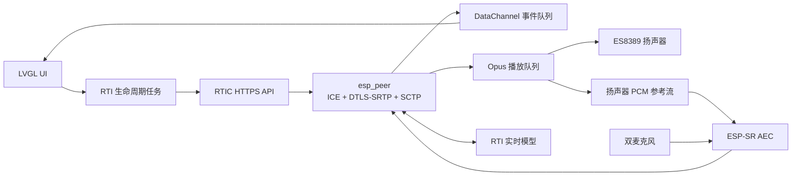

# ESP32-S31 RTI 开发与调试手册

本文总结 ESP32-S31-Korvo-1 接入 RTI AI 智能体的完整开发流程，以及本项目中
最典型问题的定位方法。它面向后续继续开发、现场演示和问题回归，不记录任何
API Key、Wi-Fi 密码等敏感信息。

## 1. 当前能力

- 800 × 480 LCD、GT1151 触摸和中英文 RTI 对话界面；
- 2.4 GHz Wi-Fi 扫描、屏幕/USB 配网、NVS 自动重连；
- HTTPS 创建和停止 RTI Session；
- WebRTC ICE、DTLS-SRTP、SCTP DataChannel；
- 16 kHz 双向 Opus 语音、实时字幕和多轮历史；
- RTIC 动态音色列表、默认音色和复制音色切换；
- 模型联网搜索；
- ESP-SR 软件参考 AEC、回声抑制和自然打断；
- 可重复 Start/Stop，并检查任务、队列和内存是否完整释放。

当前关键依赖：

| 组件 | 版本/用途 |
| --- | --- |
| ESP-IDF | 6.1+，实际开发使用 S31 版 6.2 |
| `esp32_s31_korvo_1` | `1.0.0~1`，板级支持 |
| `esp_peer` | `1.5.1`，WebRTC PeerConnection |
| `esp_audio_codec` | `~2.5.0`，ES8389 与 Opus |
| `esp-sr` | `2.4.7`，AEC 和 VAD |
| `esp_capture` | `1.0.0~1`，保留实验性官方采集路径 |
| LVGL/BSP | LCD、触摸和 UI |

## 2. 运行架构



控制面使用 HTTPS 创建 Session、获取 SDP/RTC 参数和停止 Session；媒体面使用
WebRTC。DataChannel 承载转写和状态事件，音频使用 Opus。大缓冲区和音频任务栈
放在 16 MB PSRAM，DMA、网络、加密和实时 peer task 使用内部 SRAM。

## 3. 首次开发流程

### 3.1 准备环境

```bash
source ~/esp/esp-idf-s31/export.sh
cd /Users/davy/qbox/mikud-live-s31-rti-device/devices/esp32-s31-rti

idf.py --preview set-target esp32s31
idf.py --preview menuconfig
idf.py --preview build
```

主要配置位于 `Miku RTI device`：

- RTI API Base URL；
- Device ID；
- 默认音色；
- 联网搜索；
- AEC 运行开关、自检和采集诊断开关。

### 3.2 查找串口并烧录

```bash
ls /dev/cu.usb*

idf.py --preview -p /dev/cu.usbserial-110 flash
idf.py --preview -p /dev/cu.usbserial-110 monitor
```

一根 USB 线可以同时供电、烧录和串口调试。串口未出现时，按住 `BOOT`、点按
`RESET`，再松开 `BOOT` 进入下载模式。

增量构建通常很快；但 C 函数大小变化可能导致链接地址整体移动，差分烧录会重写
较大的 app 区域。串口不稳定时使用默认 460800 baud；链路稳定时可尝试更高烧录
速率，失败后退回默认值。

### 3.3 配置 Wi-Fi

屏幕可直接扫描和输入密码。USB 配网时必须先退出 monitor，避免两个进程同时占用
串口：

```bash
~/.espressif/python_env/idf6.2_py3.14_env/bin/python \
  tools/wifi_config.py --port /dev/cu.usbserial-110 --scan-only

~/.espressif/python_env/idf6.2_py3.14_env/bin/python \
  tools/wifi_config.py --port /dev/cu.usbserial-110
```

注意：

- SSID 区分大小写；
- Wi-Fi 6 是协议代际，不等于支持 5 GHz；当前 S31 板载射频只使用 2.4 GHz；
- 普通 WPA2 热点可直接连接；
- 802.1X 企业 Wi-Fi 需要额外的企业认证和证书配置；
- 连接信息保存在 NVS，重新烧录 app 通常不会清除。

### 3.4 配置 RTI 开发凭据

不要把 Key 写进源码、命令行参数或 Git。使用环境变量和隐藏输入，通过 USB 保存到
板端 NVS：

```bash
export RTI_API_POC_APP_ID='<app-id>'
export RTI_API_POC_TOKEN='<api-key>'

~/.espressif/python_env/idf6.2_py3.14_env/bin/python \
  tools/rti_config.py --port /dev/cu.usbserial-110
```

检查和清理：

```bash
tools/rti_config.py --port /dev/cu.usbserial-110 --status
tools/rti_config.py --port /dev/cu.usbserial-110 --clear
```

API Key 必须与创建它的 RTIC 环境匹配。量产版应改为设备身份认证和短期
Session Token，并启用 NVS 加密。

## 4. 每次开发的最小闭环

1. 明确只验证一个问题，例如 AEC、字幕或 Stop；
2. 修改代码后执行 `git diff --check`；
3. `idf.py --preview build`；
4. 退出旧 monitor，再执行 `flash`；
5. 重新打开 monitor，确认 Wi-Fi、音色列表和 Ready；
6. 使用固定话术复现；
7. 同时记录主观现象和客观计数；
8. 至少执行一次 Stop；涉及生命周期时连续执行四轮；
9. 只有日志指标和听感同时通过，才认为问题解决。

建议使用三类固定测试：

- 短句：欢迎语结束后立刻说“好”，验证结尾不吞字；
- 长句：让模型连续回答 30 秒，验证字幕和播放不间断；
- 打断：模型播放中直接说话，验证 AEC 不自激且真人可以打断。

## 5. 日志怎么读

### 5.1 Session 与网络

正常顺序：

```text
wifi_manager: connected
rti_session: RTI session created
rti_session: RTC answer received
DTLS: Client handshake success
webrtc_peer: oai-events DataChannel opened
webrtc_peer: RTI PeerConnection and DataChannel are active
```

常见错误：

- `getaddrinfo() returns 202`：当前 Wi-Fi/DNS 不通，不是 RTI JSON 问题；
- `HTTP_CLIENT: Connection failed`：先验证 IP、网关、DNS和 HTTPS；
- `DTLS ... handshake fail`：检查 SDP `setup` 角色、证书生成和内存；
- `Remote candidate over limited`：远端 ICE candidate 超过库上限，需要精简或筛选；
- Session 创建成功但没有媒体：继续检查 DTLS、SCTP 和 DataChannel 是否打开。

### 5.2 字幕与对话

关键日志：

```text
input_audio_buffer.speech_started
input_audio_buffer.speech_stopped
user transcript done: ...
response.created
assistant transcript done: ...
response.done
```

判断方法：

- `speech_started` 都没有：上行被门控、麦克风无数据或音量过低；
- 很快出现 `speech_stopped`：服务端 VAD 切句；
- `user transcript done` 完整但屏幕缺字：UI 合并/历史逻辑问题；
- 日志本身就缺字：检查 VAD、AEC 输出和上行连续性；
- 当前静音切句阈值为 1100 ms，用于容忍自然停顿；
- 流式 delta 只作为临时字幕，最终以 `completed/done` 覆盖，避免中间识别堆满屏幕。

### 5.3 播放连续性

重点看：

```text
playback stats: ... queue=... underflow=... fec_decode=... plc=...
playback packet gap: ...
peer loop stats: ...
DataChannel worker stats: ... queue=... drops=...
```

健康基线：

- 播放队列稳定在目标附近；
- `underflow=0`；
- 正常网络下 `plc=0`，少量 `fec_decode` 可接受；
- DataChannel `drops=0`；
- peer task 不被 UI 长时间阻塞。

不能只凭 `packet gap` 判断听感。网络包可能有抖动，但只要预缓冲队列没有耗尽，
播放仍然连续。真正的声音空洞通常同时伴随 underflow、PLC 或队列突然归零。

### 5.4 AEC 与打断

关键日志：

```text
AEC frames=... avg=... max=... ref_wait=... ref_drop=... ref_buffer=...
AEC signal mean_abs: mic0=... mic1=... ref=... out=...
local barge-in opened from AEC: ...
barge-in echo candidate rejected: ...
```

判断方法：

- `ref_buffer` 持续增长：播放参考时钟与采集时钟漂移；
- `ref_wait/ref_drop` 快速增加：参考流供给或消费不平衡；
- 只有扬声器播放却出现真人打断：回声被误判为近端语音；
- 真人说话无法打断：门限过高、AEC 过强或 warm-up/hold 不合理；
- AEC 平均耗时应显著小于 32 ms 帧长，并给系统 idle task 留出调度机会。

### 5.5 Stop 与内存

正常 Stop 应看到：

```text
RTC stop ... audio task bits ... observed=expected
RTC stop ... worker bits ... observed=expected
esp_peer_close=0
PeerConnection closed
RTI session stopped
```

每次修改任务、队列或 WebRTC 生命周期后：

- 连续 Start/Stop 四次；
- 检查任务退出位全部返回；
- 检查 PSRAM 回到稳定基线；
- 检查内部 SRAM 没有逐轮下降；
- 不允许用关闭 watchdog 掩盖任务不让出 CPU 的问题。

## 6. 典型问题与最终处理

| 问题 | 根因 | 处理 |
| --- | --- | --- |
| 企业 Wi-Fi 看不到/连不上 | 仅 2.4 GHz，且未实现 802.1X | 使用 2.4 GHz WPA2 或补企业认证 |
| DTLS Server 握手超时 | SDP 角色路径不兼容 | ESP 主动使用 DTLS Client |
| X.509 生成失败 | 握手期内存峰值和证书生成时机 | 启动时预生成并复用证书 |
| 扬声器声音被再次识别并重复回答 | 双麦不是硬件参考；回声进入上行 | 使用实际播放 PCM 作为软件 AEC 参考 |
| 官方 `MR` AEC 路径无效 | Korvo-1 两路 ADC 都是麦克风，不是 mic+reference | 原始通道相关性诊断后禁用该路径 |
| AEC 后 watchdog 重启 | AEC、Opus 长时间占用 CPU1 | 使用 `FD_LOW_COST`，循环适度让出 CPU |
| AEC 有效但真人无法打断 | 播放期间完全闭麦 | AEC 输出 + ESP VAD + 原始能量联合判断近端语音 |
| 欢迎语后说“好”没反应 | 播放尾部保护 220 ms 吞掉短句 | 尾部保护缩短为 40 ms |
| 长回答声音断续 | DataChannel JSON/UI 在 peer loop 同步执行 | 独立 32 项事件队列和 `rti_events` task |
| 网络抖动造成空洞 | 播放缓冲不足且没有恢复手段 | 24 帧队列、12 帧预缓冲、Opus FEC/PLC |
| 字幕“先出几个字，最后整段跳出” | 节流只有首沿，没有尾沿补刷 | 80 ms 节流并在窗口结束后补刷 pending 文本 |
| 字幕刷新拖慢媒体 | 每个 delta 强制完整 LVGL layout/scroll | 流式阶段跳过同步全布局，最终文本再完整布局 |
| 用户停顿后前半句消失 | 800 ms VAD 切段，用户单独片段未入历史 | VAD 改为 1100 ms，并保留 user-only 片段 |
| Stop 卡住或第三轮失效 | 任务/队列关闭顺序和资源释放不完整 | 事件位等待任务退出，再关闭 peer 和释放资源 |
| 音色选中但 Session 未生效 | UI title 与 voice profile ID 混用 | UI 显示 title，API/Session 始终传 profile ID |

## 7. AEC 解决流程

AEC 是本项目最复杂的部分，推荐严格按以下顺序处理：

1. **先做半双工基线**：播放时闭麦，确认重复回答确实来自声学回声；
2. **验证硬件通道**：分别记录两个 ADC 通道，与扬声器 PCM 做延迟相关性；
3. **否定错误假设**：Korvo-1 两路都是声学麦，不能直接套用 mic/reference 配置；
4. **建立软件参考**：解码后的扬声器 PCM 同时写入播放设备和 reference stream；
5. **对齐时钟**：初始参考延迟 40 ms，缓冲超过 80 ms 时逐步裁剪旧样本；
6. **选 AEC 模式**：当前使用 `AEC_MODE_FD_LOW_COST`、512 sample/32 ms、
   aggressive NLP，兼顾回声消除和 CPU；
7. **防止假打断**：AEC 输出能量、ESP VAD、原始麦克风能量连续三帧同时满足才开门；
8. **保留真人打断**：打断保持 300 ms，不能简单在 AI 播放期间永久闭麦；
9. **检查调度**：记录 AEC avg/max，周期性让出 CPU，不关闭 watchdog；
10. **分场景验收**：安静播放、真人打断、连续多轮、不同音量分别验证。

每次只能调整一组参数，并同时保留：

- 原始麦克风强度；
- 扬声器参考强度；
- AEC 输出强度；
- VAD 结果；
- 门限与是否开门；
- 是否发生模型自我重复。

## 8. UI、音色和产品验证

- 顶部只保留 RTI 品牌和在线状态；
- 说话人使用“我/ME”和“RTI”，颜色及图标区分；
- 中间结果不写入历史，最终识别才落盘；
- 历史对话可滚动，保留有限轮次以控制内存；
- 音色列表实时请求 RTIC profiles；
- 列表显示可读 title，内部保存 profile ID；
- 默认音色和复制音色都在下一次 Session 创建时生效；
- 音量通过 UI 调节并保存到 `rti_settings` NVS。

产品视频前至少验证：

1. 默认音色和复制音色都能创建 Session；
2. 欢迎语、天气联网搜索、多轮追问和真人打断；
3. 字幕逐步刷新，最终文本正确；
4. 长回答无 underflow/PLC；
5. Stop 后能立即重新 Start；
6. 屏幕无文字覆盖，历史滚动正常。

## 9. 当前边界和后续工作

- `esp_peer` 当前协商结果支持 Opus in-band FEC，但 SDP 尚未启用音频 NACK；
- 接收端是定制预缓冲/FEC/PLC，不等同于 Chrome 的完整 NetEq；
- 官方 `esp_capture` 硬件参考 AEC 不适用于当前 Korvo-1 接线；
- 生产版仍需设备认证、短期 Token、NVS 加密、OTA 和量产配网；
- 流式字幕仍应继续演进为“当前句轻量 label + 历史 label”，彻底避免全文重排；
- `docs/memory-architecture.md` 中的内存测量应在媒体任务或 AEC 模式变化后重新更新。

## 10. 代码入口

| 文件 | 职责 |
| --- | --- |
| `main/app_main.c` | 启动与组件初始化 |
| `main/rti_controller.c` | Start/Stop 生命周期 |
| `main/rti_session.c` | RTIC HTTP API、音色与 Session |
| `main/webrtc_peer.c` | SDP、WebRTC、Opus、AEC、字幕事件 |
| `main/board_audio.c` | ES8389、I2S 和音量 |
| `main/board_display.c` | Wi-Fi UI、对话 UI、历史和音色 |
| `main/wifi_manager.c` | Wi-Fi 与自动重连 |
| `tools/wifi_config.py` | USB 配网 |
| `tools/rti_config.py` | USB 开发凭据配置 |
| `docs/memory-architecture.md` | 内存所有权和回归基线 |
