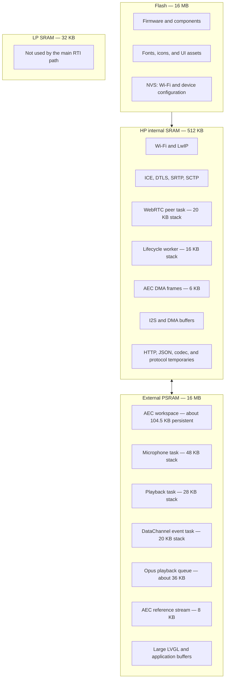
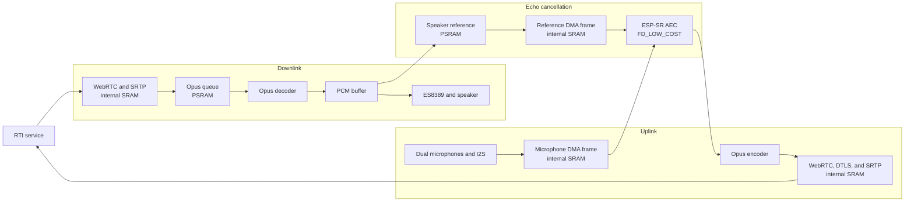
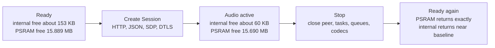

# ESP32-S31 RTI memory architecture

This document is the source of truth for the firmware's current memory
ownership and the hardware measurements used to validate it. Update the
measurements whenever the WebRTC, audio, AEC, LVGL, or task topology changes.

## Design rule

The firmware uses the available memory according to latency and access
constraints:

- internal SRAM holds DMA buffers, networking and crypto state, the WebRTC peer
  loop, and code that must keep running while flash cache is disabled;
- external PSRAM holds large persistent workspaces, audio queues, reference
  audio, and large task stacks;
- flash holds firmware, fonts, UI assets, and persistent NVS configuration;
- LP SRAM is not part of the main RTI media path.

The module provides 512 KB HP SRAM, 32 KB LP SRAM, 16 MB PSRAM, and 16 MB
flash. The complete 512 KB HP SRAM is not available to the application:
FreeRTOS, Wi-Fi, drivers, static data, and ESP-IDF components consume part of it
before the RTI Session starts.

## Realtime audio path

The playback PCM is both rendered to the ES8389 codec and copied into the AEC
reference stream. The microphone task combines that reference with the captured
microphone signal before encoding clean speech as Opus.

## Explicit allocations

The following sizes come from the current source and hardware logs. Library
internals may allocate additional memory which is included in the lifecycle
measurements but cannot be attributed exactly without allocator tracing.

| Owner | Size | Lifetime | Region |
| --- | ---: | --- | --- |
| ESP-SR AEC main workspace | about 104,500 B | firmware lifetime | PSRAM |
| ESP-SR AEC internal state | about 19,328 B | firmware lifetime | internal SRAM |
| AEC microphone/reference/output DMA frames | 6,144 B | firmware lifetime | internal SRAM |
| Microphone task stack | 48 KB | active Session | PSRAM |
| Playback task stack | 28 KB | active Session | PSRAM |
| DataChannel event task stack | 20 KB | active Session | PSRAM |
| WebRTC peer task stack | 20 KB | active Session | internal SRAM |
| RTI lifecycle worker stack | 16 KB | firmware lifetime | internal SRAM |
| Opus playback queue, 24 packets | about 36 KB | active Session | PSRAM |
| AEC speaker-reference stream, 8 frames | 8 KB | active Session | PSRAM |
| DataChannel event JSON | up to 12 KB | event processing | allocator heap |
| RTC SDP response | up to 24 KB | Session negotiation | allocator heap |
| Normal REST response | up to 8 KB | API request | allocator heap |
| User and assistant transcript buffers | 2 KB | firmware lifetime | static data |
| UI transcript/history text storage | about 10.4 KB | firmware lifetime | static data |
| LVGL 800 x 40-line draw buffer | about 64 KB at RGB565 | display lifetime | BSP/LVGL allocation |

The microphone task also allocates a 1,280-byte interleaved capture buffer, a
640-byte mono capture buffer, two 2,688-byte accumulators, and an encoder output
buffer. The playback task allocates two 4,096-byte PCM/reference buffers and one
Opus packet. Opus, MbedTLS, ICE, SRTP, SCTP, LwIP, and Wi-Fi own further
implementation-private state.

## AEC ownership and scheduling

The AEC instance uses `AEC_MODE_FD_LOW_COST` at 16 kHz with one microphone
channel, one speaker-reference channel, aggressive NLP, and a four-block filter.
Its 512-sample frame represents 32 ms of audio.

The AEC instance is created and pinned during boot instead of being repeatedly
created for every Session. This avoids heap fragmentation and makes every
Session reuse the same validated workspace. Its main allocation requests
8-bit-capable PSRAM, while the three aligned processing frames remain in
DMA-capable internal SRAM.

Playback remains the reference clock. The microphone/AEC path must not stall
speaker rendering. A short scheduler yield in the capture loop is required so
CPU1's idle task can run; disabling the watchdog is not an acceptable fix.

If AEC is unavailable, the firmware falls back to half-duplex microphone gating
to prevent the assistant's own playback from being retransmitted indefinitely.

## Measured Session lifecycle

Recent hardware Start/Stop logs produced the following profile:

| Phase | Internal SRAM free | PSRAM free | Meaning |
| --- | ---: | ---: | --- |
| before Session | about 153 KB | 15,889,388 B | includes persistent AEC |
| audio active | about 60 KB | about 15,690,452 B | WebRTC, event, and audio tasks active |
| after Stop | about 152 KB | 15,889,388 B | Session resources released |

The active Session therefore consumes approximately 93 KB of transient
internal SRAM and 198,936 B of transient PSRAM. The persistent AEC workspace is
already present in the pre-Session baseline and is not part of that PSRAM delta.

Exact PSRAM return to 15,889,388 bytes after each Stop is the current regression
baseline. Internal SRAM returns to a narrow range because asynchronous
network/system allocations do not always settle at the same instant.

## Why everything cannot live in PSRAM

1. I2S and DMA buffers require internal DMA-capable memory.
2. Wi-Fi, crypto, and the realtime peer loop need low-latency internal memory.
3. NVS and flash operations can temporarily disable the cache. PSRAM is then
   inaccessible, so the lifecycle worker must use an internal stack.
4. Keeping a measured internal reserve is necessary for networking bursts and
   prevents DTLS/ICE failures caused by heap fragmentation.

## Regression checklist

After changing the media path, task stacks, or libraries:

1. record heap telemetry before Session, after audio activation, and after Stop;
2. run at least four Start/Stop cycles;
3. confirm PSRAM returns to 15,889,388 bytes or explain the new baseline;
4. confirm internal SRAM returns to the expected narrow range;
5. speak over assistant playback to verify AEC and barge-in;
6. verify the microphone and playback tasks retain safe stack headroom;
7. check that no watchdog, cache-disabled PSRAM, DTLS, or allocation errors occur.

The authoritative implementation is in `main/webrtc_peer.c`,
`main/rti_controller.c`, `main/rti_session.c`, and `main/board_display.c`.
